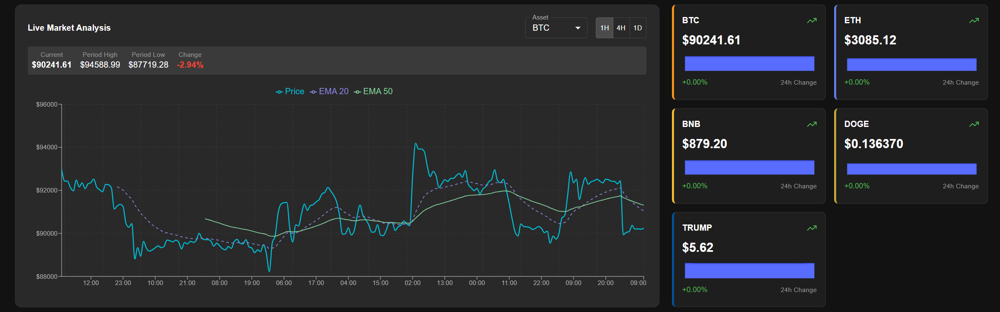
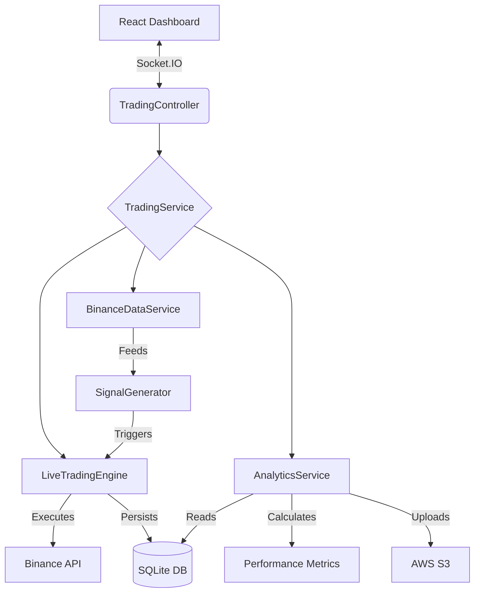

# Crypto Trend Trading Bot (V3 - Analytics Engine)

A production-ready, full-stack cryptocurrency trend-following bot built for the Raspberry Pi. It features a robust **Live Trading Engine**, a unified **Analytics "Central Brain"**, and a real-time **React Dashboard** for full control and deep performance insights.

  
  




This project is a sophisticated trend-following system executing a **SuperTrend + ADX Momentum** strategy. It is designed for "set and forget" operation with built-in fail-safes against network outages and API drift. Unlike static bots, this system features **Dynamic Asset Allocation** and **Enterprise-Grade Analytics** (Sharpe Ratio, Volatility, Signal Quality Grading).

## ✨ Key Features

-   **🛡️ Robust Live Engine**:

    -   **"Zombie Killer" Logic**: Automatically detects and repairs database/exchange mismatches (e.g., trades sold during a network timeout).
    -   **Atomic Execution**: Ensures local database state always matches Binance reality to prevent "death loops."
    -   **Signal Data Capture**: Records ADX and ATR values at the moment of entry for future strategy refinement.

-   **🧠 Unified Analytics "Central Brain"**:

    -   **Single Source of Truth**: A dedicated `AnalyticsService` that powers both the API and S3 reports, eliminating math discrepancies.
    -   **Advanced Metrics**: Calculates **Sharpe Ratio**, **Volatility**, **Win Rate**, and **Profit Factor** in real-time.
    -   **Signal Quality Grading**: Automatically grades strategy performance (Excellent/Good/Poor) based on the correlation between Trend Strength and Win Rate.

-   **☁️ Cloud Integration**:

    -   **S3 Data Lake**: Automatically uploads performance reports and signal logs to AWS S3 for long-term storage and external analysis.
    -   **Telemetry**: Full system health monitoring (CPU/RAM, API Latency).

-   **⚡ Dynamic Asset Management**:

    -   **Live Rebalancing**: Adjust capital allocation per asset (e.g., 0% BNB, 50% ETH) instantly without restarting.
    -   **Watchlist Mode**: Assets set to 0% allocation are tracked for signals but not traded.

-   **📈 Momentum Strategy (SuperTrend)**:
    -   **Trend Following**: Enters when SuperTrend flips GREEN.
    -   **Filters**:
        -   **ADX > 25**: Ensures the trend has sufficient strength.
        -   **RSI < 75**: Prevents buying at the absolute top (overbought filter).
    -   **Risk Management**: Fixed % Stop Loss or ATR-based Trailing Stops.

## 🚀 Getting Started

### 1. Installation

```bash
# Clone the repository
git clone [https://github.com/yourusername/crypto-trend-bot.git](https://github.com/yourusername/crypto-trend-bot.git)
cd crypto-trend-bot
```

Run the automated production installer

```bash
./clean-install.sh
```

2. Secure Configuration
   Generate your encrypted secrets file. You will need your Binance API Key and Secret.

```bash
./scripts/setup-secrets.sh
```

3. Launch

```bash
# Start the full stack (Backend + Frontend) via PM2
pm2 start ecosystem.config.js --env production
```

Access the dashboard at http://your-pi-ip:3000.

## 🏗 System Architecture

The application follows a Service-Oriented Architecture (SOA) optimized for data integrity.



## 🛠 Configuration Guide

1. The Strategy (SuperTrend Momentum)
   The bot uses a "Momentum Sniper" strategy tuned for trending markets.
   Entry: SuperTrend (10, 3) flips GREEN + ADX > 20.
   Exit: SuperTrend flips RED OR Stop Loss hit.
   Filters: RSI < 75 (Avoid FOMO buying).
2. Allocation Logic
   Control how much capital goes to each asset via the System Config tab.
   Example:
   Total Capital: $1,000
   ETH Allocation: 50% ($500 max position)
   SOL Allocation: 50% ($500 max position)
   BNB Allocation: 0% (Watch only, no buys)
3. Analytics & Reporting
   The Analytics Dashboard provides a deep dive into your strategy's health:
   Equity Curve: Visualizes PnL growth over time.
   Signal Quality: "Report Card" grading your entry efficiency.
   Trend Strength Analysis: Compares the ADX of Winning Trades vs. Losing Trades to help you tune your filters.
   Exit Strategy Breakdown: Shows whether trades are closing due to Signal, Stop Loss, or Trailing Stop.

## ⚠️ Disclaimer

USE AT YOUR OWN RISK.
Cryptocurrency trading involves significant risk of financial loss. This software is provided "as is" with no warranty. The authors are not responsible for any financial losses incurred while using this bot. Always start with small capital to verify stability.
