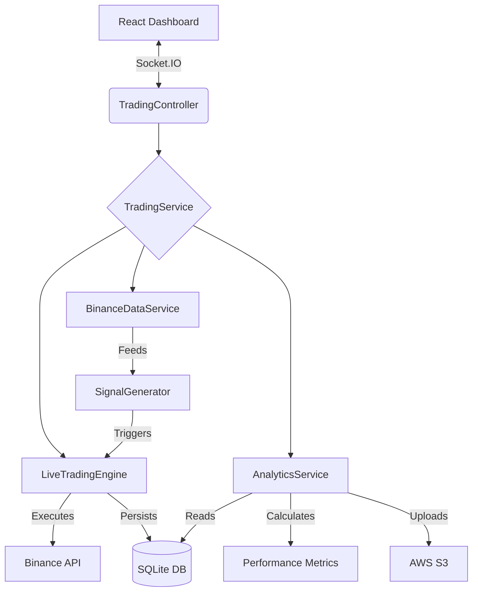

# Crypto Trend Trading Bot (V3.1 - Intraday Momentum)

A production-ready, full-stack cryptocurrency trend-following bot built for the Raspberry Pi. It features a robust **Live Trading Engine**, a unified **Analytics "Central Brain"**, and a real-time **React Dashboard** for full control and deep performance insights.

  
  


This project is a sophisticated trend-following system executing a **SuperTrend + ADX Momentum** strategy. It is currently optimized for **15-minute Intraday Volatility**, allowing for faster entries and multiple concurrent positions. Unlike static bots, this system features **Dynamic Asset Allocation** and **Enterprise-Grade Analytics** (Sharpe Ratio, Volatility, Signal Quality Grading).

## ✨ Key Features

-   **🛡️ Robust Live Engine**:

    -   **"Zombie Killer" Logic**: Automatically detects and repairs database/exchange mismatches (e.g., trades sold during a network timeout).
    -   **Atomic Execution**: Ensures local database state always matches Binance reality to prevent "death loops."
    -   **Signal Data Capture**: Records ADX, RSI, and ATR values at the moment of entry for future strategy refinement.

-   **🧠 Unified Analytics "Central Brain"**:

    -   **Trend Strength Analysis**: Compares the ADX of Winning Trades vs. Losing Trades to verify strategy health ("Optimal" vs "Inverted").
    -   **Advanced Metrics**: Calculates **Sharpe Ratio**, **Volatility**, **Win Rate**, and **Profit Factor** in real-time.
    -   **Signal Quality Grading**: Automatically grades strategy performance based on entry efficiency.

-   **📊 Enhanced Visualization**:

    -   **Live Context**: Signals widget displays real-time **Trend Direction (Bull/Bear)** and **RSI Heatmaps** (Red > 70 / Green < 30).
    -   **Detailed History**: Full data table showing Entry Price, Exit Price, Exit Reason, and Net PnL per trade.
    -   **Multi-Timeframe Charts**: Default 15m view with 1H/4H toggles.

-   **⚡ Dynamic Asset Management**:
    -   **Concurrent Execution**: Supports multiple active positions (e.g., 30% NEAR, 30% XRP, 30% BNB) simultaneously.
    -   **Live Rebalancing**: Adjust capital allocation per asset instantly without restarting.

## 🚀 Getting Started

### 1. Installation

```bash
# Clone the repository
git clone [https://github.com/yourusername/crypto-trend-bot.git](https://github.com/yourusername/crypto-trend-bot.git)
cd crypto-trend-bot
```

Run the automated production installer

```bash
./clean-install.sh
```

2. Secure Configuration
   Generate your encrypted secrets file. You will need your Binance API Key and Secret.

```bash
./scripts/setup-secrets.sh
```

3. Launch

```bash
# Start the full stack (Backend + Frontend) via PM2
pm2 start ecosystem.config.js --env production
```

Access the dashboard at http://your-pi-ip:3000.

## 🏗 System Architecture

The application follows a Service-Oriented Architecture (SOA) optimized for data integrity.



## 🛠 Configuration Guide (Recommended Setup)

1. The Strategy (Intraday Momentum)
    - The bot uses a fast-paced "Momentum Sniper" strategy tuned for 15-minute volatility.
    - Timeframe: 15m (Captures intraday pumps).
    - Entry: SuperTrend (10, 3) flips GREEN + ADX > 25.
    - Exit: SuperTrend flips RED OR Stop Loss hit.
    - Filters: RSI < 70 (Prevents buying overextended tops).
2. Allocation Logic
   _ Control concurrency via the System Config tab.
   _ Total Capital: $1,000 (Example - set your own capital allocation here)
   _ Asset Allocation:
   _ NEAR: 30% ($300 max)
   _ XRP: 30% ($300 max)
   _ BNB: 30% ($300 max)
   Note: This leaves 10% buffer and allows the bot to hold all 3 assets simultaneously.
3. Analytics & Reporting
    - The Analytics Dashboard provides a deep dive into your strategy's health:
    - Equity Curve: Visualizes PnL growth over time.
    - Trend Strength Analysis: Visualizes if you are "fighting the trend" (Losing ADX > Winning ADX).
    - Exit Strategy Breakdown: Shows whether trades are closing due to Signal, Stop Loss, or Trailing Stop.

## ⚠️ Disclaimer

USE AT YOUR OWN RISK.
Cryptocurrency trading involves significant risk of financial loss. This software is provided "as is" with no warranty. The authors are not responsible for any financial losses incurred while using this bot. Always start with small capital to verify stability.
