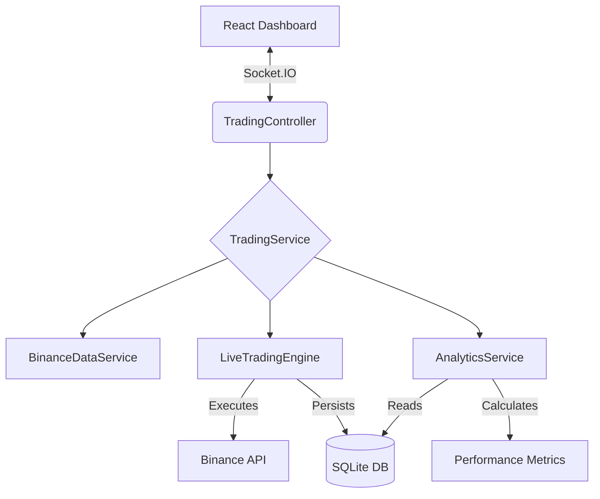
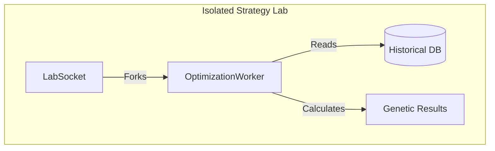

# Crypto Trend Trading Bot (V3.2 - AI Strategy Lab)

A production-ready, full-stack cryptocurrency trend-following bot built for the Raspberry Pi. It features a robust **Live Trading Engine**, a unified **Analytics "Central Brain"**, and a new **AI-Powered Strategy Lab** for genetic optimization.

  
  


This project is a sophisticated trend-following system executing a **SuperTrend + ADX Momentum** strategy. It is currently optimized for **15-minute Intraday Volatility**, allowing for faster entries and multiple concurrent positions. Unlike static bots, this system features **Dynamic Asset Allocation**, **Genetic Parameter Optimization**, and **Enterprise-Grade Analytics**.

## ✨ Key Features

### 🧪 AI Strategy Lab (NEW)

-   **Genetic Optimizer**: Automatically tests a "Universe" of 15+ assets against 120 days of historical data to find the highest-performing pairs.
-   **Isolated Architecture**: Runs simulations in separate Node.js child processes (forked threads) to ensure **zero impact** on the live trading heartbeat.
-   **"Dream Team" Construction**: Automatically ranks assets by "Signal Quality" (Profit \* Win Rate) and constructs a diversified portfolio.
-   **One-Click Deployment**: Apply optimized asset weights directly to your live configuration instantly.

### 🛡️ Robust Live Engine

-   **Equity-Based Sizing**: Calculates position size based on **Total Portfolio Value** (Cash + Crypto) rather than just available cash. This allows multiple assets to be traded at full size without "shrinking" later positions.
-   **"Zombie Killer" Logic**: Automatically detects and repairs database/exchange mismatches (e.g., trades sold during a network timeout).
-   **Atomic Execution**: Ensures local database state always matches Binance reality to prevent "death loops."

### 🧠 Unified Analytics "Central Brain"

-   **Trend Strength Analysis**: Compares the ADX of Winning Trades vs. Losing Trades to verify strategy health ("Optimal" vs "Inverted").
-   **Advanced Metrics**: Calculates **Sharpe Ratio**, **Volatility**, **Win Rate**, and **Profit Factor** in real-time.
-   **Signal Quality Grading**: Automatically grades strategy performance based on entry efficiency.

### 📊 Enhanced Visualization

-   **Live Context**: Signals widget displays real-time **Trend Direction (Bull/Bear)** and **RSI Heatmaps**.
-   **Smart Notifications**: "Actionable Signals" logic filters out noise, alerting you only to BUY/SELL events (ignoring HOLDs).
-   **Detailed History**: Full data table showing Entry Price, Exit Price, Exit Reason, and Net PnL per trade.

## 🚀 Getting Started

### 1. Installation

```bash
# Clone the repository
git clone [https://github.com/yourusername/crypto-trend-bot.git](https://github.com/yourusername/crypto-trend-bot.git)
cd crypto-trend-bot
```

Run the automated production installer

```bash
./clean-install.sh
```

2. Secure Configuration
   Generate your encrypted secrets file. You will need your Binance API Key and Secret.

```bash

./scripts/setup-secrets.sh
```

3. Launch

```bash

# Start the full stack (Backend + Frontend) via PM2
pm2 start ecosystem.config.js --env production
```

Access the dashboard at http://your-pi-ip:3000.

## 🏗 System Architecture

The application follows a Service-Oriented Architecture (SOA) optimized for data integrity and performance.





## 🛠 Configuration Guide (Recommended Setup)

1. The Strategy (Intraday Momentum)
    - Timeframe: 15m (Captures intraday pumps).
    - Entry: SuperTrend (10, 3) flips GREEN + ADX > 25.
    - Exit: SuperTrend flips RED OR Stop Loss hit.
    - Filters: RSI < 70 (Prevents buying overextended tops).
2. Auto-Optimization Workflow
    - Navigate to the Strategy Lab tab.
    - Click AI Auto-Optimize.
    - The system will download missing data and test 15 assets (BTC, ETH, SOL, NEAR, etc.).
    - Review the "Dream Team" Report to see the optimal portfolio mix.
    - Click Apply Recommended to update the testing portfolio to run a test for the dream team.
3. Manual Allocation Logic
   _ Total Capital: $1,000 (Example)
   _ Asset Allocation:
   _ NEAR: 30% ($300 max)
   _ SOL: 30% ($300 max) \* BNB: 30% ($300 max)
   Note: The new "Equity-Based Sizing" ensures the 3rd asset gets a full $300 allocation even if the first two trades are already open.

## ⚠️ Disclaimer

USE AT YOUR OWN RISK.
Cryptocurrency trading involves significant risk of financial loss. This software is provided "as is" with no warranty. The authors are not responsible for any financial losses incurred while using this bot. Always start with small capital to verify stability.
