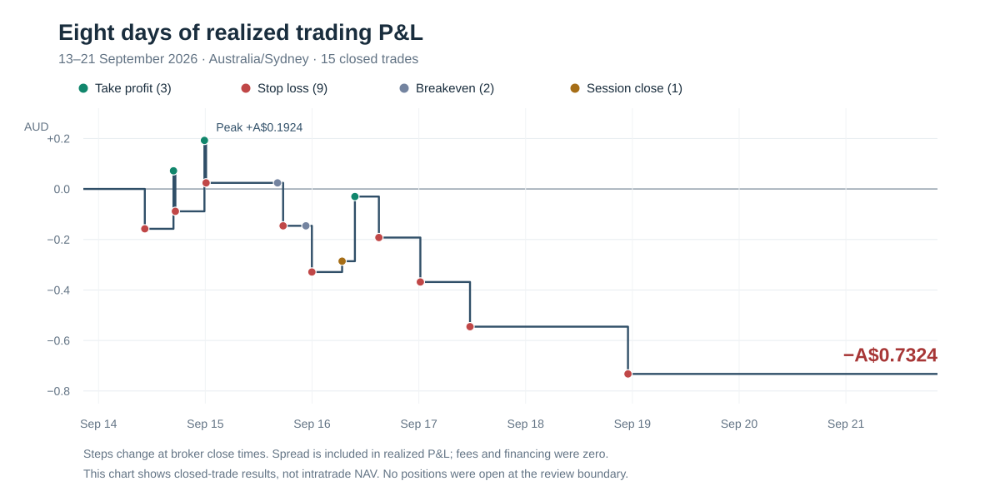

# Eight-day trading review — 21 September 2026

**Reviewed interval: 13 September 20:35 through 21 September 20:35 AEST, end excluded** (13 September 10:35 through 21 September 10:35 UTC). This is eight elapsed days, including the intervening weekend and the latest partial Monday. All times below are Sydney/AEST unless stated otherwise. Entry-cohort and realized-period totals coincide: no position crossed either boundary.

**Assessment: execution and risk handling look materially more coherent than in the September 6 audit, but this week's trading lost money. The observed re-entry problem is real strategy behaviour; the evidence does not show a duplicate-order or take-profit-state bug. A separate, reproducible excursion-measurement defect makes historical target-tuning statistics less trustworthy.**

This was a production read-only review plus local analysis, isolated tests and documentation. No trading rules, settings, orders, enabled state, processes, production source, Git commits/publication or deployment were changed. Current production and local source were both clean at `5c250a74b33705eda15dc2b94d2e84a5afff30a3`. Production is **m15-intraday-v3.3 / strategy 1.1.3**, run `live_a8458577-5451-4c6b-ae9b-adfe95d2fcf3`, config `51bcdfe44054c4f69668`. All 15 trades in this interval belong to that single cohort. Earlier documentation saying v3.3 awaited deployment is superseded by this observation.

## 1. Broker-verified performance

| Measure | Result |
| --- | ---: |
| Closed trades | 15 |
| Positive / negative / zero net outcomes | 4 / 9 / 2 |
| Net realized result | **−A$0.7324** |
| Balance | A$97.2380 → A$96.5056 |
| Return on opening balance | **−0.7532%** |
| Gross gains / gross losses | +A$0.8093 / −A$1.5417 |
| Profit factor | **0.525** |
| Positive-outcome rate, including flat trades | 26.7% |
| Mean result | −A$0.04883 per trade |
| Total / mean net cash-risk-normalized R | **−4.281R / −0.285R** |
| Maximum drawdown between realized balance observations | A$0.9248, approximately 0.95% of the local peak |
| Median / longest holding time | 36m09s / 5h44m36s |

R here means net AUD P&L divided by reconstructed initial cash stop risk: absolute units × original stop distance × entry quote-to-AUD loss conversion. It is not the risk budget or a later breakeven stop distance. Reconstructed initial risk ranged A$0.1560–A$0.1898. Price-distance R used later for price-path analysis is a different measure; summed price-distance outcomes were −4.187R. Currency conversion and cash P&L rounding explain small differences between these measures.

Every entry price, closing price and net AUD result matched the direct OANDA trade records and closing transactions. There were no unrecorded broker trades in the interval, cash transfers, financing, commissions or guaranteed-stop fees. Opening and closing transaction half-spread costs totalled **A$0.2283**, already reflected in realized P&L; subtracting them again would double-count cost. OANDA's [trade definitions](https://developer.oanda.com/rest-live-v20/trade-df/) distinguish realized P&L, financing and closing price; the verification used those fields and transaction costs separately.

The preceding ten post-review trades, before this interval, earned **A$0.4822**. They span v3, v3.1 and v3.2, so they are context rather than a controlled comparison. Across all 25 trades since September 6, the net is **−A$0.2502**. Early gains have been given back. Fifteen trades do not establish long-run expectancy, and their clustering makes simple independent-trade confidence calculations optimistic. Neither profitable initial days nor this losing week isolates the effect of the software release.

## 2. The take-profit and re-entry observation

**AUD/USD on September 14 is the strongest immediate same-pair example.**

1. Trade **3195** sold at **13:43:26**, entry **0.71475**, and hit its target at **16:50:47**, exit **0.71385**, earning **A$0.2297**.
2. Every scan from **16:51 through 16:59** returned `NO_TRIGGER`. There was no immediate take-profit callback opening another trade.
3. The newly completed **16:45–17:00 M15 candle** qualified at 17:00:23. Trade **3207** sold at **17:00:26**, entry **0.71368**, **9m38.8s after the target**. H1 ADX was 41.916; M15 RSI was 28.97, within the existing short range of 28–48. Both breakout and pullback conditions passed.
4. That trade stopped at **17:16:28**, exit **0.71428**, losing **A$0.1604**. The next same-candle signal at 17:01 had correctly been suppressed. Combined, the two trades retained only **A$0.0693** of the first winner.

The code treats a later completed candle as a new setup. It does **not** require the trend to reset, a new pullback to form after the exit, or a pause after a winning trade. Its rolling four-bar pullback window can still refer to pre-exit price action. That is an important strategy property: the bot can close a successful trend position and buy or sell the same move again at a less favourable level with a newly positioned stop. Adding a post-profit gate would change the strategy rather than repair a demonstrated duplicate-order defect.

The complete denominator changes the interpretation:

| Target trade | Next trade on the same pair | Delay after target | Result of that next trade |
| --- | --- | ---: | ---: |
| AUD/USD 3195 | AUD/USD SELL 3207 | 9m39s | Stop loss, −A$0.1604 |
| USD/JPY 3217 | USD/JPY BUY 3261 | 22h12m | Breakeven, A$0 |
| USD/JPY 3295 | USD/JPY BUY 3317 | 13h53m | Stop loss, −A$0.1760 |

All **three next trades across the whole bot** after a target lost, but two changed instrument: 3217 was followed by EUR/USD 3229, and 3295 by AUD/USD 3307. Those are not immediate same-pair re-entries. The three target-plus-next-bot-trade pairs still totalled **+A$0.2755**; this pattern alone does not account for the week's overall loss.

The wider repeated-exposure concern also appears after breakeven: AUD/USD **3239 → 3251** lost A$0.1701 after a 44m18s gap; USD/JPY **3261 → 3273** lost A$0.1829 after 53m51s. These are worth tracking alongside post-target entries, rather than defining the hypothesis solely around winners.

Earlier evidence cuts both ways. September 9 had USD/JPY target **3121 → 3133** stop loss after 17m21s. September 7 had target **3073 → 3085** target after just 2m09s, then another winning same-pair entry. A blanket post-target ban would also exclude successful continuation trades. These older examples used earlier releases and are explicitly outside the eight-day totals.

**No duplicate filled setup was found among the 15 trades.** Source tracing and real coordinator → signal generator → engine → broker-shaped reconciliation tests confirm that a filled same-candle setup remains suppressed, including after restart, while a later qualifying candle may enter. The v3.3 reconsideration change only re-arms confirmed local pricing declines and retains the original price anchor. No take-profit event clears that suppression. See [signal identity/suppression](../../backend/src/services/signalGenerator.js), [completed-candle triggers](../../backend/src/strategies/intradayMomentum.js) and the [September 11 contract](2026-09-11-entry-rejection-and-reconsideration.md).

## 3. Losses are broader than one re-entry pattern

| Pair | Trades | Positive / negative / flat | Net AUD |
| --- | ---: | --- | ---: |
| USD/JPY | 9 | 3 / 5 / 1 | −0.3011 |
| AUD/USD | 5 | 1 / 3 / 1 | −0.2631 |
| EUR/USD | 1 | 0 / 1 / 0 | −0.1682 |
| GBP/USD | 0 | — | — |

Eight buys lost A$0.1434; seven sells lost A$0.5890. All buys were USD/JPY, so direction and instrument effects cannot be separated here. Actual session cohorts were also all negative: Tokyo 4 trades/−A$0.2392; Sydney–Tokyo overlap 4/−A$0.1027; London–New York overlap 7/−A$0.3905. These are saved entry-session sets, not fixed UTC bins.

| Actual trigger combination | Trades | Net AUD |
| --- | ---: | ---: |
| Pullback only | 9 | −0.3214 |
| Pullback and breakout together | 4 | −0.4987 |
| Breakout only | 2 | +0.0877 |

Thirteen trades display the pullback label, but four also satisfied breakout. The overlap group again looks weak, as it did in the September 6 review; that is a research lead, not enough evidence to remove it. The pure pullback group was also negative this week, and the positive breakout-only group contains just two trades.

The **last four trades all stopped out**, losing A$0.7024. A valid 24-hour cooldown separated the third and fourth; a four-loss history is not proof that the three-loss protection failed. Nine initial-stop losses averaged approximately −1R in price-distance terms, consistent with the intended stops rather than unexplained oversized exits.

Seven entries filled more than three minutes after their signal candle closed; the latest was about 13m28s into the next candle. This results from the existing within-candle scanning, live pricing gates and permitted reconsideration. They still used the latest completed M15 candle and respected their original decision-price bound. This subgroup includes two targets and lost A$0.1815 overall, so the data does not justify imposing a new age cutoff. Three minutes is a descriptive split, not an existing requirement or proposed threshold.

## 4. Targets, breakeven and subsequent price paths

The exit distribution was **3 targets (+A$0.7664), 9 initial stops (−A$1.5417), 2 breakeven stops (A$0), and 1 session close (+A$0.0429)**. No trade reached the six-hour limit in this interval. Trade **3283** closed at **06:45:09 on September 16**, corresponding to the configured New York 16:45 exit window, about nine seconds after it began. No missed timed exit was observed. The earlier September 8 six-hour exit remains separate evidence that the time-stop path has run live.

For the standing take-profit question, I fetched OANDA **bid/ask M5 candles**, separately from the bot's excursion telemetry. The table uses fully completed bars beginning after each broker exit and ending before the original entry's six-hour deadline or earlier rollover deadline. For buys it uses bid prices; for sells, ask prices. Values are price-distance R from the original entry, not hypothetical AUD profit.

| Target trade | Highest subsequent favourable R | Lowest subsequent R | Last complete-bar close before original deadline |
| --- | ---: | ---: | ---: |
| AUD/USD 3195 | +3.68R | +0.68R | +3.18R |
| USD/JPY 3217 | +2.14R | −3.30R | −3.08R |
| USD/JPY 3295 | +4.03R | −0.14R | +1.61R |

All three winners continued past +2R. The AUD/USD winner's later price path supports the user's concern that closing and then resetting entry/stop levels can turn ordinary trend retracement into a new loss. But USD/JPY 3217 also shows substantial profit protected before a later reversal. The two breakeven trades differ: AUD/USD 3239 subsequently reached only +1.20R; USD/JPY 3261 later reached +1.79R, within its original six-hour window.

Looking beyond winners, **seven of nine stopped-out trades never revisited their original target** in these retained post-exit bars before the original deadline. Two did: 3207 and 3317. For 3317 the subsequent path also went beyond −4R before ending strongly favourable, illustrating why “eventually recovered” does not establish that simply widening a stop is safe or profitable.

These bars establish observed continuation and reversal, not an alternative strategy return. They omit partial boundary bars, cannot establish within-bar event order, and do not model new executions, changing AUD conversion or which later trades would be excluded while holding the first position. Any comparison of 1.5R, a larger fixed target or another exit must include all entries, breakeven, the one-position constraint and transaction costs. This review does not establish an optimal target.

## 5. Confirmed measurement defect and smaller evidence gaps

**P2 — excursion statistics can include prices after the broker closed the trade.** Twelve of fifteen trades have `sampledExcursion.lastObservedAt` later than their broker-confirmed exit, by **79–5,142 ms**. The engine checks locally open positions and records a quote before synchronizing broker closures. Once the broker closure is discovered, the already-aggregated maxima remain attached to the trade. [Monitoring and sampling implementation](../../backend/src/services/LiveTradingEngine.js).

An isolated test through the actual `monitorPositions` path reproduces a post-target quote being recorded as about **2R favourable excursion** even though the position already closed at **1.5R**. This is a demonstrated analytics defect; no evidence connects it to the week's fills or losses. Trade 3217's saved maximum of 1.703R is suspicious but cannot be attributed to that final sample with certainty: timestamps for each extreme are not retained, and broker fill improvement is another possibility.

Correction direction: preserve sufficient provisional observations/timestamps to exclude events outside the broker-confirmed position lifetime when closure becomes known. Moving synchronization earlier alone does not remove the race. Preserve the existing distinctions between event time, receipt time and execution time. Historical aggregates cannot be reliably repaired from the last timestamp alone. Until corrected, do not treat saved MFE/MAE as exact in-position extrema or use them alone to choose a target.

**Lower priority — scalar RSI columns are empty.** All 124 actionable signal rows and decisions have null scalar RSI, although every full signal context retains the computed M15 RSI. The adapter copies ADX but omits RSI from the fields used by persistence. Execution checks and the dashboard use the nested value, so no skipped RSI filter or current dashboard metric failure was established. Populate the existing scalar fields consistently in a later small telemetry correction; do not infer missing historical values without their source context. [Signal adapter](../../backend/src/services/signalGenerator.js), [signal persistence](../../backend/src/repositories/signalRepository.js).

**Existing operational gap — S3 reports remain unconfigured.** Reporting is enabled in intent but the destination credentials/region are incomplete; the scheduler is not running and successful upload checkpoints are absent. This was already recorded September 6. Local trade evidence exists. Whether to restore that destination depends on whether it is still wanted; this review did not send reports or introduce notifications.

## 6. Entry funnel and risk controls

**46,040 pair observations → 48 distinct setups → 124 emitted attempts → 15 fills.** Repeated one-minute scans and pricing retries are not independent trading opportunities. All 124 attempts had one matching durable decision; every fill had a completed order intent with one submission attempt. There were no unmatched broker trades, duplicate fills, open-trade overlaps, quarantines or unresolved intents in the reviewed evidence.

| Decision result | Attempts | Setups ending in this result |
| --- | ---: | ---: |
| Filled | 15 | 15 |
| Spread too wide | 56 | 3 |
| Entry-price deviation | 18 | 2 |
| Cost/stop too high | 8 | 1 |
| Already holding that pair | 13 | 13 |
| One-position limit | 8 | 8 |
| Loss cooldown, stored under EXPOSURE_LIMIT | 6 | 6 |
| **Total** | **124** | **48** |

Thirteen setups had multiple attempts. **Five ultimately filled after a pricing rejection**, producing one target, one breakeven and three stops, net **−A$0.2751**. All thirteen retained one unchanged decision-price anchor. No submitted/filled or otherwise ineligible setup was rearmed. The correction is now demonstrated to create live fills; it is not demonstrated to improve profitability.

The rejected quotes actually exceeded the configured limits: spread 1.3–1.8 pips versus 1.2; movement 1.75–13.85 pips versus 1.5; cost/stop 16.67–18.33% versus 15%. Two fills passed an exactly 1.2-pip spread. No recurrence of the earlier exact-boundary floating-point rejection was observed. All fifteen fills were within their original 1.5-pip reference bound; maximum observed absolute deviation was 1.45 pips. Their recorded worst-case fill risk stayed below each contemporaneous risk budget. Total signal-to-fill time was 2.815–8.179 seconds, including local preparation; that is not a measurement of broker request latency alone.

All fifteen market entries requested attached stop-loss and take-profit orders, and the broker transaction/order records confirm them. Subsequent fill anchoring and breakeven changes are present. This verifies the observed lifecycle, not protection through every hypothetical outage. The current risk settings remain 0.25% of buffered sizing capital, A$100 capital ceiling and one open position.

The three-loss cooldown began **September 17 at 11:30:06.993** and expired **September 18 at 11:30:06.993**, rejecting six setups. It survived the intervening maintenance restart. The next fill at 22:15 on September 18 demonstrates that entries resumed; current risk status is READY with one loss since that expiry.

GBP/USD had six qualifying setups and 31 attempts: one exhausted opportunity was blocked by an existing position, one by spread, and four ended in loss-cooldown rejection once their quotes passed. There is no unexplained GBP execution failure in this sample. EUR/USD had two setups: one filled and one was blocked by capacity.

On **September 21 through the cutoff**, the bot emitted no actionable BUY/SELL signals. Its 4,936 pair observations were explained by market closure, pair sessions, neutral H1 regime, weak ADX, missing M15 confirmation and the post-reopen candle wait. Absence of Monday trades is not evidence of a stuck disabled state.

## 7. Operations, validation and limits

Production was enabled and flat when inspected: balance/NAV **A$96.5056**, zero broker trades, zero pending orders. A final health read was **healthy**, with entry readiness passing. An earlier health request coincided with an in-flight reconciliation and briefly reported uncertainty; eight subsequent samples showed it cleared with fresh successful syncs and no error. That transient is not classified as an outage.

The exact interval contained **12 logged error records: eight pricing timeouts and four reconciliation timeouts**. Some occurred together, so twelve records do not establish twelve distinct outages. There were no persisted order-submission/preparation failures or observed missed protective exits. Fourteen warnings saying “closed externally on Oanda” were the normal broker TP/SL/breakeven closures, not evidence of manual interference.

Seven shared scan gaps, about 118–178 seconds around 03:00, match scheduled backup/boot records; no other gap exceeded 90 seconds. No restart occurred at the September 16 03:00 maintenance time while trade 3283 was still open. Three final database backup files dated September 19–21 were retained. This pass checked their inventory, not backup integrity or a restore. Root storage was 49% used with about 28 GB available; available memory was about 6.7 GiB. No resource exhaustion was observed.

Validation used **269 existing tests across five strategy/signal/retry/engine/exit suites**, plus **three isolated orchestration reproductions**, all passing on Node 22.23.1. External services and persistence were mocked in those tests; production reads were separate. The [retained isolated fixtures and run instructions](evidence/2026-09-21/README.md) cover TP/same-candle suppression/new-candle entry, restart persistence, and the excursion defect. The last test asserts existing faulty behaviour and is an evidence reproducer, not a claim that it is fixed. No frontend build, deployment, manual order or live failure injection was performed.

This is a complete review of the retained trade, decision, retry, risk, exit and operating evidence for this interval, not an exhaustive proof that every code path is defect-free. No portfolio snapshots existed in the extracted interval, so drawdown is realized-close drawdown, not continuous mark-to-market drawdown. Poll-based excursions can miss between-poll extremes in addition to the closure-lag defect. Full tick history, independently replayed alternative strategies, live outage tests, off-host restore and email delivery were not evaluated. Macroeconomic attribution was not established from these records.

## 8. Recommended next work

1. **Correct excursion lifetime accounting before using that telemetry to tune exits.** It is the reproduced defect in this review. Keep historical uncertainty explicit; preserve broker P&L and timestamp contracts.
2. **Frame re-entry as a deliberate strategy question.** The evidence supports investigating whether a genuinely new pullback or trend reset should be required after a target or breakeven exit. Define the candidate rule and evaluation criteria before another cohort; compare successful continuation as well as failed repetitions. Do not silently add an arbitrary delay or ban all post-profit trades as a bug fix.
3. **Evaluate target and re-entry together.** Larger targets change which subsequent entries are possible under one-position capacity. Include all fifteen trades, the older winning continuation sequences, costs, breakeven and reversal paths. The present sample justifies investigation, not selecting a target, side, pair or trigger subgroup as superior.
4. **Keep the existing small limits while collecting evidence.** The accounting and risk protections are behaving more consistently, but the observed week had a negative average realized return and no subgroup result justifies scaling. Retain separate release cohorts and make the eventual strategy change explicit. Scalar RSI consistency is a small follow-up; S3 destination configuration is an outstanding operational choice.

No corrective implementation or deployment was made in this review. The existing one-way local → GitHub → production workflow and user-managed publication/deployment remain in force.

## 9. Full trade ledger and retained evidence

The [machine-readable trade ledger](evidence/2026-09-21/performance-window-ledger.csv) includes exact timestamps, initial risks, actual trigger combinations and entry-session sets. [Performance calculations](evidence/2026-09-21/performance-summary.json), [broker verification](evidence/2026-09-21/broker-verification.json), [subsequent price-path measurements](evidence/2026-09-21/post-exit-analysis.json) and the [source manifest](evidence/2026-09-21/manifest.json) are retained with this report. Raw exported operational data remains in the local temporary audit directory identified by the manifest; it was not added to the repository.

| Broker ID | Entry, AEST | Pair / side | Exit, AEST | Outcome | Net AUD | Initial cash risk AUD |
| --- | --- | --- | --- | --- | ---: | ---: |
| 3185 | 14 Sep 09:53:31 | USD_JPY SELL | 14 Sep 10:24:12 | STOP_LOSS | -0.1577 | 0.1580 |
| 3195 | 14 Sep 13:43:26 | AUD_USD SELL | 14 Sep 16:50:47 | TAKE_PROFIT | +0.2297 | 0.1560 |
| 3207 | 14 Sep 17:00:26 | AUD_USD SELL | 14 Sep 17:16:28 | STOP_LOSS | -0.1604 | 0.1605 |
| 3217 | 14 Sep 22:30:31 | USD_JPY BUY | 14 Sep 23:48:20 | TAKE_PROFIT | +0.2808 | 0.1898 |
| 3229 | 15 Sep 00:00:31 | EUR_USD SELL | 15 Sep 00:10:27 | STOP_LOSS | -0.1682 | 0.1692 |
| 3239 | 15 Sep 13:53:28 | AUD_USD SELL | 15 Sep 16:14:10 | BREAKEVEN_STOP | +0.0000 | 0.1624 |
| 3251 | 15 Sep 16:58:27 | AUD_USD SELL | 15 Sep 17:29:32 | STOP_LOSS | -0.1701 | 0.1703 |
| 3261 | 15 Sep 22:00:33 | USD_JPY BUY | 15 Sep 22:36:42 | BREAKEVEN_STOP | +0.0000 | 0.1749 |
| 3273 | 15 Sep 23:30:33 | USD_JPY BUY | 15 Sep 23:57:30 | STOP_LOSS | -0.1829 | 0.1828 |
| 3283 | 16 Sep 01:00:32 | USD_JPY BUY | 16 Sep 06:45:09 | SESSION_CLOSE | +0.0429 | 0.1676 |
| 3295 | 16 Sep 09:25:33 | USD_JPY BUY | 16 Sep 09:37:42 | TAKE_PROFIT | +0.2559 | 0.1695 |
| 3307 | 16 Sep 10:18:28 | AUD_USD SELL | 16 Sep 15:01:05 | STOP_LOSS | -0.1623 | 0.1625 |
| 3317 | 16 Sep 23:30:33 | USD_JPY BUY | 17 Sep 00:20:33 | STOP_LOSS | -0.1760 | 0.1754 |
| 3327 | 17 Sep 11:12:32 | USD_JPY BUY | 17 Sep 11:30:06 | STOP_LOSS | -0.1770 | 0.1762 |
| 3337 | 18 Sep 22:15:29 | USD_JPY BUY | 18 Sep 23:00:46 | STOP_LOSS | -0.1871 | 0.1871 |
